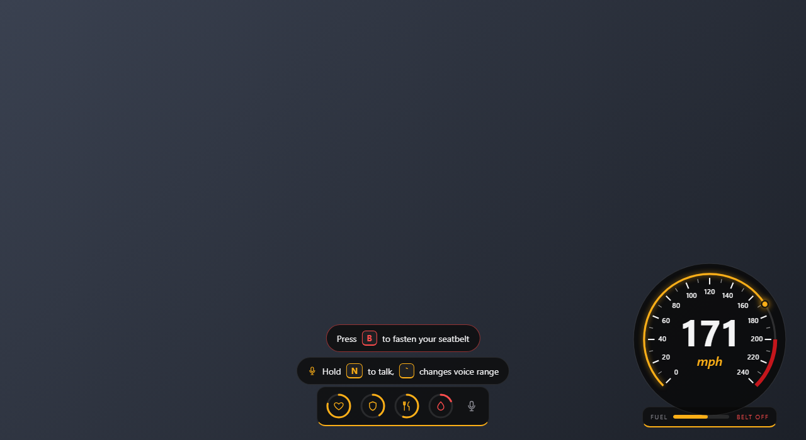

# custom-hud

A clean HUD for FiveM (Qbox), built from scratch with React + TypeScript. Black and yellow theme, a gauge-style speedometer and context hints that teach new players the controls.




https://github.com/user-attachments/assets/d5a110ff-30c1-4506-91f7-b71ddeddc31f


## Features

- Status rings: health, armor (only when you have some), hunger, thirst. A ring turns red and pulses when it is low.
- Voice indicator that lights up while you talk.
- Gauge speedometer with scale, red zone and glowing pointer. MPH or KPH.
- Fuel bar and seatbelt status.
- Always-visible key reference panel on the left side (editable list in `config.lua`, players can hide it with `/hudkeys`).
- Context hints:
  - Driving 5 seconds without a seatbelt: "Press B to fasten your seatbelt".
  - Pressing the exit key while buckled: "Unfasten your seatbelt first".
  - Pressing F twice at a locked vehicle: "This vehicle is locked. Press L to unlock it".
  - Voice hint for new players that disappears forever after the first time they speak.

## Requirements

Data sources, all standard on a Qbox server:

- `qbx_core` (hunger and thirst state, `isLoggedIn`)
- `ox_lib`
- `ox_fuel` (fuel state), `qbx_seatbelt` (seatbelt state), `qbx_vehiclekeys` (door lock status)
- `pma-voice` (talking status, Mumble)
- Node.js (only to build the UI)

Developed and tested on Qbox with FiveM build 3258.

## Installation

1. Copy this folder into your `resources` directory.
2. Build the UI:
   ```
   cd web
   npm install
   npm run build
   ```
3. Stop your current HUD (for example `stop qbx_hud`) and `ensure custom-hud`.

This HUD does not replace the minimap customizations, stress effects or money display of `qbx_hud`.

## Configuration

See [config.lua](config.lua): units, gauge scale, polling rate, hint delays and the key labels shown in hints. The key labels are text only, the real keys are configured in `qbx_seatbelt`, `qbx_vehiclekeys` and `pma-voice`.

## Commands

| Command | Description |
| --- | --- |
| `/hudkeys` | Show or hide the key reference panel (remembered) |
| `/hudreset` | Show the voice hint again (useful for testing) |

## How it works

- Data is collected in `client.lua` and sent to the UI only when a value changes.
- The fast per-frame check for the exit key runs only while the player is in a vehicle with the seatbelt on, otherwise it sleeps.
- The locked vehicle hint uses a key binding instead of a polling loop.

## UI development

```
cd web
npm run dev
```

In a browser the page shows sample data. Open `?speed=171` to freeze the speed for design checks.

## License

All rights reserved. See [LICENSE](LICENSE).
